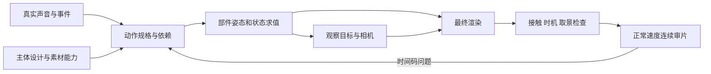

# Frameboard 动作系统根因与实施计划

日期：2026-11-16。状态：根因已做源码核对和隔离复现；下面的产品改动待用户确认。专用 skill 为本地源文件，尚未安装到全局技能目录，也没有自动接入工作台任务。

本轮读取了全局镜头约束、Remotion 项目规则、通胀制作记录与质量修复制作单。当前任务是研究和形成可实施方案，没有新做影片或生成收费素材。本计划使用已有引擎和本地验证，预计新增外部服务费用为 0；如后续确需新配音或生图，另按具体请求确认。

## 已确认的根因

| 问题 | 代码事实 | 对结果的影响 |
|---|---|---|
| 多条图形仍作为一个刚体移动 | `video/MotionScene.jsx:23` 将一个 node 的 paths 包在共同 transform 中；`shared/motion-dynamics.mjs:14` 插值位置、旋转、缩放、透明度、描线 | 同一个 node 内的手脚没有独立动作通道。虽然可以人为拆成多个 node，但 schema 中未提供关节、父子连接与接触语义。 |
| “在动”被用作“动作实现”的证据 | `shared/director-quality.mjs:51` 的 activity 依赖属性变化幅度；`shared/explanation-plan.mjs` 核对变化前后值和结果时间 | 足以验证一部分运输/图形变化，无法证明行走、抓握、开合等特定动作成立。 |
| 换素材会消除原图形层 | `shared/shot-images.mjs:21` 对绑定 node 返回 `paths:[]` 和单个 media | 整人物图片替换保留根轨迹，失去原路径。模型收到“设计真实动作”的要求，也无法让扁平图内部自动表演。 |
| 素材身份主要依靠单镜绑定和共享图版 | `shared/visual-continuity.mjs` 已有按 ID 复用设计；`shot-images.mjs` 按单镜 nodeId 替换外观 | 现有基础应复用，但还需要跨镜主体设计版本、动作能力和部件级替换策略，才能防止局部换图与整体设计冲突。 |
| 相机计划检查与观察效果分离 | `shared/camera-plan.mjs:53` 验 focusId 存在、理由非空；没有在该模块核对事件期间目标区域的可读性 | 合法的相机计划不等于有效观察。其他排版/机制检查已有部分可见性检查，仍需围绕关键事件覆盖。 |
| 新旧运镜规则打架 | `server/motion.mjs:40` 允许有解释节拍时固定构图；`:43` 仍要求把旧固定镜头细化成多个视觉镜头；`camera-plan.mjs:58` 保留旧配额分支 | 新任务的生成意图仍可能被旧规则拉向为变化而变化。旧资料可读取和新任务沿用旧创作规则应分开。 |

以上行号是本次核对位置，实施前按符号重新定位。完整源文件 SHA256 随 [隔离复现记录](probe-result.json) 保存。

已有 2026-11-16 通胀复盘记录了第 5 段 34.04–34.08 秒人物一帧换姿势、第 7 段 10 条人物路径只随整体移动。本轮核对了这些记录，没有冒称重新完整观看原七镜。

## 隔离复现结果

使用现有测试 fixture，在内存构造“购物者行走，双腿交替迈步”，保留 10 条不变路径，仅让根位置从 80 变成 550。

- 当前 `validateDesignEvidence` 接受，内部姿态变化为 0。
- 加入解释节拍和实际 x 前后值后，当前 `validateExplanationEvidence` 仍接受。
- 单独把相机中心移到画外，`validateCameraPlan` 在 purposeDriven 分支接受。这里只证明相机模块缺少该检查，不代表整条导出链会放过画外结果。
- 对同一 node 应用整对象图片绑定，路径数量从 10 变成 0，替换为一个 media。

复现只调用现有模块，没有修改项目、声音或审核状态，也没有渲染；不能作为审美或视听检查。脚本位于 `scripts/probe-frameboard.mjs`，传入工作区绝对路径即可复核。

## 建议的系统结构

核心改动是让同一份可计算的世界状态用于渲染、接触检测、标注定位和取景检查。不能分别实现四套坐标算法，导致画面与检查互相矛盾。

## 待批准的实施范围

### 1 对象能力和部件层级

拟新增 `shared/actor-rig.mjs`，扩展 `server/motion.schema.json`、`shared/motion-plan.mjs` 和 `video/MotionScene.jsx`：

- 将主体稳定身份与镜内 nodeId 分开；部件记录 parentId、局部枢轴、可动画属性。
- 保留已有平面 node 格式，旧资料不因缺少骨骼而不能播放；新任务按动作类型声明所需能力。
- 统一求值局部姿态到世界姿态，再应用相机。首版支持刚性分层/关节动作；柔性网格或复杂形变不假装已经支持。
- 关节层级限制循环、丢失父节点与非法比例。非均匀缩放和旋转可能产生剪切，选择保留完整矩阵或对首版父级比例明确限制作图，不能直接错误地拆回旧标量。
- 让 `MeasuredLayout`、`layout-geometry`、连接端口和注释使用同一坐标结果，防止新增动作把已有文字避让弄坏。

### 2 动作事件与真实时机

拟新增 `shared/performance-plan.mjs`，扩展现有 `action-timing`、`explanation-plan`、`director-quality`、`server/motion.mjs` 与相关生成 schema：

- 复用现有真实语音 cue、explanationBeat 和动作要求编号；动作再关联作用时刻、结果时间窗与事件依赖。
- 区分根位移、内部姿态、机制状态和外观显现。行走不能只提交根位移为证；合法的刚体运动不强加内部变化。
- 用明确的动作能力及参数定义验证目标，不靠正则从自然语言猜全部动作。未知动作保留明确人工审片路径，不静默降级为平移。
- 以接触点、支撑、附着、开口等与动作相关的几何关系检验关键事件；检查作用前、作用时和作用后。
- 不把所有阶段同起同停，不机械使用通用相位差。必要提前量和滞后量写明原因，按实际语义和帧率量化。

### 3 整片美术与素材动作能力

拟新增 `shared/actor-catalog.mjs`，扩展素材绑定、`visual-continuity`、模型输入和现有保存/导出通路：

- 建立主体设计版本及部件目录，记录轮廓、比例、材质、光向、色板和动作能力；已有视觉参考继续作依据。
- 新镜头引用同一主体的设计，保持允许变化项与固定项清楚。
- 图片按实际能力绑定到刚体或某个部件。单张站姿图不能被采纳为行走表演的完整替代。
- 若采用姿势序列，校准同一主体、枢轴、尺寸、接触点与遮挡；过渡由动作需要决定，三张不同姿势交叉淡化不能自动算动作合格。
- 最终检查基于完成绑定后的输出。修改设计、部件、事件时机或素材指纹，使对应样片和检查过期，避免旧批准掩盖新外观。

### 4 按事件安排相机

复用 `shared/camera-plan.mjs` 和当前相机轨道，扩展观察目标区域、关联事件和可读区间：

- 清理生成提示中的冲突，新任务统一按观察目的生成；旧资料继续读取，重生成时迁移到现行规则。
- 将需要看清的手、书、通道开口或比较区域投到屏幕，检查关键事件期间的尺寸、裁切、遮挡和字幕区。
- 近景允许主体其他部位出画，不再拿根节点是否在画面中心当作唯一标准。
- 相机移动、固定或切换由事件需要决定；不新增运动次数、镜头数量或缩放幅度配额。

### 5 接入与验证

复用已有动效库、实际声音、视觉附件、生成回执校验和正常速度审片入口，不新增收费服务或运行时依赖。更新生成输入、版本指纹、保存与重开、导出工程，让新字段从计划传到最终画面，不能只存在于提示词。

研发记录写入 `remotion/PROJECT_LOG.md`；相应测试覆盖新模块及旧路径兼容性。新技能作为项目任务输入的设计指导，产品的硬性约束由 schema、编译器和检查器负责，不能声称安装技能即完成代码修复。

## 验收内容

| 验证 | 通过条件 |
|---|---|
| 原缺陷反例 | 仅整体移动的“行走”、未接触先带走道具、整图替换关节角色、关键事件画外均产生可定位的失败 |
| 合法正例 | 刚体平移、正确的关节行走、接触后拿取、目的充分的固定镜头可通过 |
| 坐标一致性 | 父级旋转/缩放时，渲染部件、关节点、标注和取景检查的世界位置一致 |
| 时间与确定性 | 换 fps、乱序抽帧、倒序取帧、重开项目后相同帧得到同样姿态；音频时间或对象设计改变后相关检查失效 |
| 素材统一 | 同一主体跨两镜的身份/设计版本一致；部件替换保持动作能力；不同角度并排核对视觉一致性 |
| 现有功能 | 相关单测、完整回归与生产构建通过；真实浏览器走生成结果校验、保存重开和预览流程 |
| 对照样片 | 先做约 8–15 秒最能暴露问题的实际片段，沿用连续原声及 BGM，统一美术；交付可播放预览、关键姿态截图、同版 SRT 和编辑数据 |
| 导演复看 | 正常速度看完整片段；记录接触、姿态变化、作用结果及镜头交接的具体时间码；未听到音轨时不填写听审通过 |

样片长度以完整语义与主动作所需时间为准。选镜、入出点和旁白实际对应关系在实施时确认；沿用已审脚本/图版，若改变其内容则按制作规则走对应审核。验证片达到要求后再推广旧七镜，不提前修改其用户审核状态。

## 本次交付与后续授权

本次完成本地 skill 源文件、专业来源和候选适用边界、上面四项隔离复现以及具体模块实施方案。官方 skill 格式检查、本地链接与 UI 元数据检查通过，见 [验证记录](validation.json)；这些检查不等于成片质量验证。未安装第三方动效技能，也未修改 Remotion 生产代码。为运行官方格式检查，仅在 `视频制作/.cache/skill-validation-deps` 隔离安装了 PyYAML 6.0.3，未修改系统 Python 或影片运行时依赖。

`remotion/AGENTS.md` 明确要求：“每项开发任务开始前，先在聊天中提交实施计划”及“等用户明确确认后，再执行该计划”。本计划用于完成这一步；用户确认后再实施上述产品改动。确认的范围是上述底层修复与一个短对照样片，新增收费生成不包含在内。
